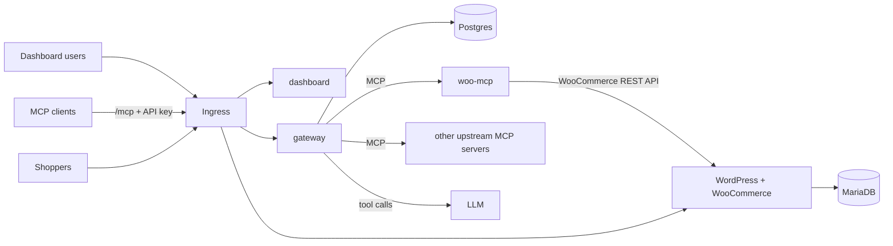

# WooCommerce Hosting with a Team MCP Gateway on Kubernetes

A WooCommerce store, a purpose-built WooCommerce MCP server, and a team MCP gateway with a dashboard and chat agent, all deployed on Kubernetes with Helm. An admin registers upstream MCP servers once. Every team member then reaches all enabled servers through a single MCP endpoint with a personal API key, or through the chat agent in the dashboard. Upstream credentials never leave the gateway.

The same charts run on local k3d and on a k3s VPS. The only differences are in the values files.

## Architecture



| Component   | Responsibility                                                                                                   |
| ----------- | ---------------------------------------------------------------------------------------------------------------- |
| `store`     | WordPress + WooCommerce on MariaDB with persistent storage. A bootstrap Job installs and configures WooCommerce. |
| `woo-mcp`   | MCP server over Streamable HTTP that exposes products and orders as tools. Reachable only from the gateway.      |
| `gateway`   | Admin and team API, upstream registry, aggregated MCP endpoint, audit log, and chat agent.                       |
| `dashboard` | React SPA for server management, team and API keys, audit log, and chat.                                         |

The design and tradeoffs are in [`docs/DESIGN.md`](docs/DESIGN.md). The threat model is in [`docs/THREAT_MODEL.md`](docs/THREAT_MODEL.md).

## Repository layout

```
apps/
  woo-mcp/      WooCommerce MCP server
  gateway/      API, MCP gateway, chat agent
  dashboard/    React dashboard
charts/
  store/        WordPress, MariaDB, bootstrap Job, woo-mcp
  platform/     gateway, dashboard, Postgres
  demo-upstreams/
docs/
scripts/
```

## Local setup

_In progress._

## Production-like setup (k3s)

_In progress._

## Usage

### Place an order

_In progress._

### Connect an MCP client

_In progress._

### Use the chat agent

_In progress._

## Additional features

_In progress._
