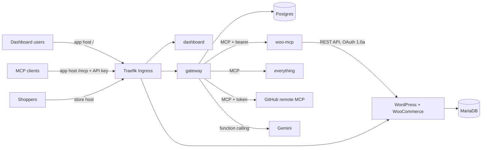

# WooCommerce Hosting with a Team MCP Gateway on Kubernetes

A WooCommerce store, a purpose-built WooCommerce MCP server, and a team MCP gateway with a dashboard and chat agent, all deployed on Kubernetes with Helm. An admin registers upstream MCP servers once. Every team member then reaches all enabled servers through a single MCP endpoint with a personal API key, or through the chat agent in the dashboard. Upstream credentials never leave the gateway.

The same charts run on local k3d and on a k3s VPS. The only differences are in the values files.

## Architecture



| Namespace        | Component           | Responsibility                                                                                                                                        |
| ---------------- | ------------------- | ----------------------------------------------------------------------------------------------------------------------------------------------------- |
| `store`          | WordPress + MariaDB | The shop. Database and `wp-content` on PVCs. A bootstrap Job installs WooCommerce, enables Cash on Delivery and seeds products.                       |
| `store`          | `woo-mcp`           | MCP server (Streamable HTTP) exposing products and orders as tools. ClusterIP only, reachable only from the gateway.                                  |
| `platform`       | `gateway`           | Dashboard API, upstream registry, aggregated `/mcp` endpoint, audit log, tool permissions, chat agent.                                                |
| `platform`       | `dashboard`         | React SPA served by nginx.                                                                                                                            |
| `platform`       | Postgres            | Users, API keys, servers (encrypted credentials), audit log.                                                                                          |
| `demo-upstreams` | `everything`        | The MCP reference server, registered twice to demonstrate tool-name collisions.                                                                       |
| `platform`       | `provisioner`       | Creates and deletes additional stores from the dashboard (Helm releases in `store-<name>` namespaces). The only component with Kubernetes API access. |

Design and tradeoffs: [`docs/DESIGN.md`](docs/DESIGN.md). Threat model: [`docs/THREAT_MODEL.md`](docs/THREAT_MODEL.md).

## Local setup

Requirements: Docker (Docker Desktop or OrbStack, with about 6 GB of memory available), `k3d` 5.9+, `kubectl`, `helm` 4, Node 22 and `pnpm` 9.

```bash
pnpm install
make cluster-up     # k3d cluster "urumi": k3s v1.36.5, ports 80/443 on localhost
make deploy-local   # build images, import them into k3d, install store, demo-upstreams and platform
make e2e            # end-to-end checks of the whole definition of done
```

The first deploy takes about 4 minutes, most of it image builds and the WooCommerce download.

### URLs and credentials

| What              | Where                                                                                                                                                       |
| ----------------- | ----------------------------------------------------------------------------------------------------------------------------------------------------------- |
| Storefront        | http://store.127.0.0.1.nip.io                                                                                                                               |
| WooCommerce admin | http://store.127.0.0.1.nip.io/wp-admin, user `admin`, password: `kubectl -n store get secret wordpress -o jsonpath='{.data.admin-password}' \| base64 -d`   |
| Dashboard         | http://app.127.0.0.1.nip.io, user `admin@urumi.local`, password: `kubectl -n platform get secret gateway -o jsonpath='{.data.admin-password}' \| base64 -d` |
| MCP endpoint      | http://app.127.0.0.1.nip.io/mcp                                                                                                                             |

All passwords and keys are generated by Helm on first install, kept in Kubernetes Secrets, and reused on upgrades.

### Local domain approach

The local hostnames use `nip.io`, a public wildcard DNS service: `<anything>.127.0.0.1.nip.io` resolves to `127.0.0.1`. k3d maps ports 80/443 on localhost to Traefik, which routes by host. This needs no `/etc/hosts` edits and works for any number of hosts. If there is no internet DNS, add the two hosts to `/etc/hosts` pointing at `127.0.0.1`.

### Chat agent model

The chat agent needs an LLM API key. Locally, `values-local.yaml` uses OpenRouter (OpenAI-compatible, model `google/gemini-2.5-flash`). Put the key in a gitignored file and deploy:

```bash
printf 'llm:\n  apiKey: "<openrouter key>"\n' > charts/platform/values-secrets.local.yaml
make deploy-platform
```

`values-prod.yaml` uses Google's Gemini API directly (`llm.provider: gemini`). Any OpenAI-compatible endpoint works: set `llm.provider: openai-compatible`, `llm.baseUrl`, `llm.model` and `llm.apiKey`. The key is stored in Secret `platform/gateway` and never leaves the gateway.

## Usage

### Place an order

1. Open http://store.127.0.0.1.nip.io/shop/ and add a product to the cart.
2. Check out. Fill in any address and choose **Cash on delivery**.
3. In WooCommerce admin, the order appears under **WooCommerce → Orders** with status _Processing_.

### Invite a member and get an API key

1. Log in to the dashboard as admin. Open **Team**, invite a member, and send them the single-use invite link.
2. The member opens the link, sets a password, then opens **My API keys** → **Generate key**. The key is shown once, together with ready-to-paste client configuration.

Admins can also issue and revoke keys for any member from the Team page.

### Connect an external MCP client

Claude Code:

```bash
claude mcp add --transport http urumi http://app.127.0.0.1.nip.io/mcp \
  --header "Authorization: Bearer urk_..."
```

Cursor or any client that reads `.mcp.json`:

```json
{
  "mcpServers": {
    "urumi": {
      "type": "http",
      "url": "http://app.127.0.0.1.nip.io/mcp",
      "headers": { "Authorization": "Bearer urk_..." }
    }
  }
}
```

MCP Inspector: `npx @modelcontextprotocol/inspector`, transport _Streamable HTTP_, URL as above, header `Authorization: Bearer urk_...`.

The client sees every enabled server's tools as `<server>__<tool>`, for example `woo__list_orders`, `everything-a__echo` and `everything-b__echo`. Example prompts:

- "What orders came in today?"
- "Find today's orders and add up their totals with the everything get-sum tool" (uses two upstreams).

### Use the chat agent

Open **Chat** in the dashboard and ask, for example, "Create a product called Demo Hoodie priced at 999", then "What orders came in today?". Every tool call appears as a card with its arguments, result and duration. The agent calls tools through the gateway's own `/mcp` endpoint as the logged-in user, so its calls appear in the audit log under that user with `via = chat`.

### Create more stores (multi-store)

Open **Stores**, enter a name, and press **Create store**.

- The provisioner installs a complete store (WordPress, MariaDB, bootstrap Job, woo-mcp) as Helm release `store-<name>` in its own namespace, with a ResourceQuota and LimitRange.
- The store gets its own host: `http://<name>-shop.127.0.0.1.nip.io`.
- Once it is ready, its MCP server is registered in the gateway automatically, with tools named `store-<name>__list_orders` and so on.
- **Delete** removes the MCP registration, the release and the namespace, including the store's volumes and Secrets.
- Each user may own up to `provisioner.maxStoresPerUser` stores (default 2).
- A failed store can be retried.

`make e2e-stores` runs the whole flow:

1. Creates two stores in parallel.
2. Checks that both are ready and registered.
3. Checks cross-store isolation, the guardrails and the provisioner's permission limits.
4. Deletes one store and checks that its tools and namespace are gone.

### Manage servers

On **Servers**, admins see each server's status (Connected / Unreachable / Disabled), last error and tools, and can add, edit, disable or remove servers. A server needs a Streamable HTTP URL and an optional credential (bearer token or custom header). Credentials are write-only.

Example: add GitHub's remote MCP server with URL `https://api.githubcopilot.com/mcp/x/issues`, credential type _Bearer token_, and a GitHub token.

## Production-like setup (k3s VPS)

The same charts deploy to a single k3s node, with values changes only. Target: a 2 vCPU / 8 GB ARM or x86 VM with ports 80 and 443 open.

1. **DNS.** Point `*.<domain>` at the VM, or use `<vm-ip>.sslip.io`, which needs no DNS setup.
2. **Install k3s and cert-manager** on the VM:
   ```bash
   sudo ./scripts/vps/install-k3s.sh
   ```
   Then edit the email in `scripts/vps/cluster-issuer.yaml` and run `kubectl apply -f scripts/vps/cluster-issuer.yaml`.
3. **Push images** from your machine. The images are multi-arch, so they run on amd64 and arm64:
   ```bash
   echo "$GITHUB_TOKEN" | docker login ghcr.io -u <user> --password-stdin
   make push REGISTRY=ghcr.io/<user>/urumi
   ```
   Make the packages public, or add an `imagePullSecret`.
4. **Secrets.** Put the LLM key in `charts/platform/values-secrets.prod.yaml` (gitignored, `llm.apiKey`). Everything else is generated in the cluster.
5. **Deploy** with your kubeconfig pointing at the VM:
   ```bash
   make deploy-prod REGISTRY=ghcr.io/<user>/urumi DOMAIN=<vm-ip>.sslip.io
   ```

What changes between `values-local.yaml` and `values-prod.yaml`:

| Concern   | Local                                             | Production                                                                                                           |
| --------- | ------------------------------------------------- | -------------------------------------------------------------------------------------------------------------------- |
| Domain    | `127.0.0.1.nip.io`                                | `--set global.domain=<domain>`                                                                                       |
| TLS       | off                                               | on: cert-manager `letsencrypt-prod`, HTTP-01 through Traefik; plain HTTP redirects to HTTPS; cookies become `Secure` |
| Images    | built locally, imported into k3d                  | `ghcr.io/...`, set with `--set *.image.repository`                                                                   |
| Storage   | `local-path`, small PVCs                          | `local-path` (k3s), larger PVCs; swap the class for a cloud CSI driver                                               |
| Resources | small requests and limits                         | larger requests and limits                                                                                           |
| Secrets   | generated by Helm; LLM key from a gitignored file | same mechanism, separate gitignored file                                                                             |

### Upgrade and roll back

```bash
helm history store -n store
make deploy-store                 # or: helm upgrade store charts/store -n store -f ... --set ...
helm rollback store <revision> -n store
scripts/upgrade-rollback.sh       # scripted rehearsal: values change, verify, roll back, verify data
```

- Images are tagged with a hash of their sources, so an upgrade restarts only the components whose code changed.
- The store's bootstrap Job also runs on rollback, so WordPress settings follow the rolled-back values.
- Rollbacks never touch the PVCs. Products, orders, users and keys survive both directions.
- Gateway migrations are additive, so an older gateway image runs against a newer schema.

## Additional features

Stand-out items from the brief:

| Item                                                                                                                                                                                                                                                                                                                       | Where                                                                                                                |
| -------------------------------------------------------------------------------------------------------------------------------------------------------------------------------------------------------------------------------------------------------------------------------------------------------------------------- | -------------------------------------------------------------------------------------------------------------------- |
| Tool permissions per role: hidden from the tool list, rejected and audited when called directly                                                                                                                                                                                                                            | `apps/gateway/src/policies.ts`, dashboard **Permissions** page                                                       |
| Security hardening: SSRF guard, default-deny ingress and egress NetworkPolicies everywhere, non-root read-only containers, encrypted upstream credentials, no service-account tokens                                                                                                                                       | `apps/gateway/src/ssrf.ts`, `charts/*/templates/networkpolicy.yaml`, `docs/THREAT_MODEL.md`                          |
| Production-like VPS deployment with TLS                                                                                                                                                                                                                                                                                    | `values-prod.yaml`, `scripts/vps/`, `make push` / `make deploy-prod`                                                 |
| Upgrades and rollback                                                                                                                                                                                                                                                                                                      | `scripts/upgrade-rollback.sh`, section above                                                                         |
| **Bonus: multi-store provisioning.** Create/delete from the dashboard, a namespace, database, volumes and host per store, automatic MCP registration, NetworkPolicy isolation, ResourceQuota/LimitRange, max stores per user, safe retries and restarts, least-privilege RBAC plus an admission policy for the provisioner | `apps/provisioner`, `charts/platform/templates/provisioner.yaml`, dashboard **Stores** page, `scripts/e2e-stores.sh` |
| Clear reporting of why an upstream is unreachable or a call failed                                                                                                                                                                                                                                                         | Servers page `last_error`, audit log outcome and error text                                                          |

## Development

```bash
make check        # typecheck, lint, format check, unit tests (gateway tests start a throwaway Postgres container)
make helm-lint
make e2e          # against the running local cluster
```

Repository layout:

```
apps/
  woo-mcp/          WooCommerce MCP server
  gateway/          API, MCP gateway, chat agent, migrations
  dashboard/        React dashboard
images/everything/  pinned image for the MCP reference server
charts/
  store/            WordPress, MariaDB, bootstrap Job, woo-mcp
  platform/         gateway, dashboard, Postgres
  demo-upstreams/   in-cluster third-party MCP servers
docs/               design and threat model
scripts/            k3d config, e2e checks, upgrade rehearsal, VPS setup
```
