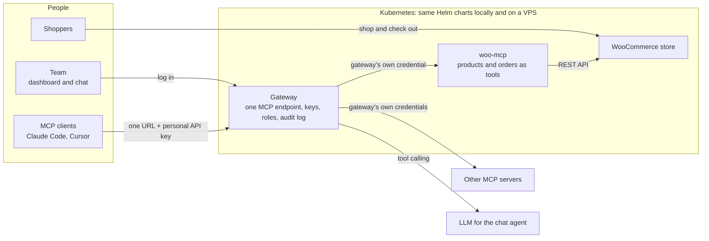

# WooCommerce Hosting with a Team MCP Gateway on Kubernetes

A WooCommerce store on Kubernetes, an MCP server for that store, and a gateway that turns every MCP server an admin connects into one endpoint for the whole team.

An admin registers MCP servers once, in a dashboard. Each team member then gets one URL and a personal API key. That pair works in Claude Code, Cursor or any other MCP client, and the chat agent in the dashboard uses the same tools. Upstream credentials stay inside the gateway: browsers, MCP clients and the LLM never see them.

Everything runs in Kubernetes and is installed with Helm. The same charts run on a laptop (k3d) and on a VPS (k3s). Only the values files differ.



## The parts

- **Store.** WordPress with WooCommerce, backed by MariaDB. Products, orders and uploads live on persistent volumes. A setup Job installs WooCommerce, turns on Cash on Delivery and adds sample products.
- **woo-mcp.** The MCP server for the store, written for this project. It exposes products and orders as tools: list and create products, list and fetch orders, change an order's status, and read store info. It calls WooCommerce's REST API, and only the gateway can reach it.
- **Gateway.** Connects to every registered MCP server and offers all of their tools on one endpoint, `/mcp`. It also owns users, roles, API keys, tool permissions and the audit log.
- **Dashboard.** The React app for admins and members: servers and their status, team and keys, audit log, permissions, stores and chat.
- **Chat agent.** An LLM chooses tools, and the gateway runs them as the logged-in user, through the same `/mcp` endpoint an external client uses.
- **Provisioner (bonus).** Creates and deletes extra stores from the dashboard, each in its own namespace, and registers each store's MCP server automatically.

How the pieces connect, and why they are built this way, is in [`docs/DESIGN.md`](docs/DESIGN.md). What can go wrong, and what stops it, is in [`docs/THREAT_MODEL.md`](docs/THREAT_MODEL.md).

## Where to find each deliverable

| The brief asks for                                        | Where                                                                                                                                                                        |
| --------------------------------------------------------- | ---------------------------------------------------------------------------------------------------------------------------------------------------------------------------- |
| Local setup                                               | [Run it locally](#run-it-locally)                                                                                                                                            |
| VPS or production-like setup                              | [Deploy to a VPS](#deploy-to-a-vps-k3s)                                                                                                                                      |
| Place an order, connect an MCP client, use the chat agent | [Demo walkthrough](#demo-walkthrough)                                                                                                                                        |
| Source code                                               | [`apps/dashboard`](apps/dashboard), [`apps/gateway`](apps/gateway), [`apps/woo-mcp`](apps/woo-mcp); chat agent in [`apps/gateway/src/agent.ts`](apps/gateway/src/agent.ts)   |
| Helm charts, local and production values                  | [`charts/store`](charts/store), [`charts/platform`](charts/platform), [`charts/demo-upstreams`](charts/demo-upstreams), each with `values-local.yaml` and `values-prod.yaml` |
| System design and tradeoffs                               | [`docs/DESIGN.md`](docs/DESIGN.md)                                                                                                                                           |
| Threat model                                              | [`docs/THREAT_MODEL.md`](docs/THREAT_MODEL.md)                                                                                                                               |
| Bonus and stand-out items attempted                       | [Beyond the brief](#beyond-the-brief)                                                                                                                                        |

## Run it locally

You need Docker (Docker Desktop or OrbStack, with about 6 GB of memory), `k3d` 5.9+, `kubectl`, `helm` 4, Node 22 and `pnpm` 9.

```bash
pnpm install
make cluster-up     # k3d cluster "urumi" with ports 80/443 on localhost
make deploy-local   # build the images, load them into k3d, install all three charts
make e2e            # check the whole definition of done end to end
```

The first deploy takes about 4 minutes, mostly image builds and the WooCommerce download.

| What              | URL                                    | Login               |
| ----------------- | -------------------------------------- | ------------------- |
| Storefront        | http://store.127.0.0.1.nip.io          | none                |
| WooCommerce admin | http://store.127.0.0.1.nip.io/wp-admin | `admin`             |
| Dashboard         | http://app.127.0.0.1.nip.io            | `admin@urumi.local` |
| MCP endpoint      | http://app.127.0.0.1.nip.io/mcp        | an API key          |

Helm generates every password and key on first install, stores them in Kubernetes Secrets and reuses them on upgrades. Read the two admin passwords with:

```bash
kubectl -n store get secret wordpress -o jsonpath='{.data.admin-password}' | base64 -d   # WooCommerce
kubectl -n platform get secret gateway -o jsonpath='{.data.admin-password}' | base64 -d  # dashboard
```

**Local hostnames.** `nip.io` is a public wildcard DNS service: any name ending in `.127.0.0.1.nip.io` resolves to `127.0.0.1`. k3d forwards ports 80 and 443 on localhost to Traefik, which routes by hostname. No `/etc/hosts` edits are needed, and every new store gets a working hostname. Without internet DNS, add the hosts to `/etc/hosts` pointing at `127.0.0.1`.

**Chat agent model.** The chat agent needs an LLM API key. Locally it uses a free OpenRouter model, `nvidia/nemotron-3.5-lightning:free`, so a key with no credit works. Free models are rate-limited and can be withdrawn; `cohere/north-mini-code:free` and `nvidia/nemotron-3-ultra-550b-a55b:free` are drop-in alternatives through `llm.model`. Put the key in a gitignored file and redeploy:

```bash
printf 'llm:\n  apiKey: "<openrouter key>"\n' > charts/platform/values-secrets.local.yaml
make deploy-platform
```

Production values use Google's Gemini API directly. Any OpenAI-compatible endpoint works too (`llm.provider: openai-compatible`, plus `llm.baseUrl`, `llm.model` and `llm.apiKey`). The key is stored in Secret `platform/gateway` and never leaves the gateway.

## Demo walkthrough

This follows the brief's definition of done, with an admin (user A) and a member (user B).

### 1. Place an order

1. Open http://store.127.0.0.1.nip.io/shop/ and add a product to the cart.
2. Check out with any address and choose **Cash on delivery**.
3. In WooCommerce admin, the order is under **WooCommerce → Orders** with status _Processing_.

### 2. Invite a member and give them a key

1. As admin, open **Team**, invite a member and send them the single-use invite link.
2. The member opens the link, sets a password, then opens **My API keys** and selects **Generate key**. The key is shown once, with client configuration ready to paste.

Admins can also issue and revoke keys for any member on the Team page.

### 3. Connect an MCP client

Claude Code:

```bash
claude mcp add --transport http urumi http://app.127.0.0.1.nip.io/mcp \
  --header "Authorization: Bearer urk_..."
```

Cursor, or any client that reads `.mcp.json`:

```json
{
  "mcpServers": {
    "urumi": {
      "type": "http",
      "url": "http://app.127.0.0.1.nip.io/mcp",
      "headers": { "Authorization": "Bearer urk_..." }
    }
  }
}
```

MCP Inspector: run `npx @modelcontextprotocol/inspector`, choose _Streamable HTTP_, and use the same URL and header.

The client sees every enabled server's tools, named `<server>__<tool>`: for example `woo__list_orders`, `everything-a__echo` and `everything-b__echo`. The prefix keeps two servers' tools apart even when they share a name. Try:

- "What orders came in today?"
- "Find today's orders and add up their totals with the everything get-sum tool." This needs two different servers.

### 4. Use the chat agent

Open **Chat** in the dashboard and ask, for example, "Create a product called Demo Hoodie priced at 999", then "What orders came in today?". Each tool call appears as a card with its arguments, result and duration. The agent calls tools as the logged-in user, so the audit log lists those calls under that user, marked `via = chat`.

### 5. Manage servers and watch failures

**Servers** lists each server's status (Connected, Unreachable or Disabled), its last error and its tools. Admins can add, edit, disable or remove servers. A server needs a Streamable HTTP URL and, optionally, a bearer token or a custom header. Credentials are write-only: nobody can read them back.

- **Disable** a server: its tools disappear from connected clients and from the chat agent.
- **Kill** an upstream's pod with `kubectl -n demo-upstreams delete pod -l app.kubernetes.io/name=everything`: the other servers keep working, and the dashboard shows it as Unreachable until Kubernetes replaces the pod.
- **Revoke** a key: the next call with it is rejected, even inside an open session.
- **Audit**: every call above appears on the Audit page under the user who made it.

To add a remote server, for example GitHub's: URL `https://api.githubcopilot.com/mcp/x/issues`, credential type _Bearer token_, and a GitHub token.

### 6. Create more stores

Open **Stores**, enter a name and select **Create store**. The provisioner installs a complete store (WordPress, MariaDB, setup Job, woo-mcp) in its own namespace, `store-<name>`, with resource quotas. The store gets its own address, `http://<name>-shop.127.0.0.1.nip.io`. When it is ready, its tools appear for everyone as `store-<name>__list_orders` and so on.

**Delete** removes the store's tools first, then its release, namespace, volumes and Secrets. Each user can own up to two stores by default (`provisioner.maxStoresPerUser`), and a failed store can be retried. `make e2e-stores` runs the whole flow, including isolation between stores and the provisioner's permission limits.

## Deploy to a VPS (k3s)

The same charts deploy to a single k3s node; only values change. The production values were verified end to end on local k3s with real TLS from cert-manager: certificates issued, HTTP redirected to HTTPS, `Secure` cookies, and WooCommerce calls through woo-mcp behind TLS termination. They have not been deployed to a public VM.

`values-prod.yaml` is sized for a small ARM VM with 1 core and 6 GB, for example Oracle Cloud's Always Free `VM.Standard.A1.Flex`. Open TCP 22, 80 and 443 in the cloud firewall. The Kubernetes API stays private and is reached through an SSH tunnel.

1. **Prepare the VM.** This opens the host firewall, installs k3s (the same version as local) and cert-manager, and writes a kubeconfig.
   ```bash
   make vps-setup VPS=ubuntu@<vm-ip>
   make vps-tunnel VPS=ubuntu@<vm-ip>      # keep running in a second terminal
   export KUBECONFIG=~/.kube/urumi-vps.yaml
   sed 's/admin@example.com/<your email>/' scripts/vps/cluster-issuer.yaml | kubectl apply -f -
   ```
   Oracle's Ubuntu images block inbound and forwarded traffic at the host firewall. `scripts/vps/prepare-host.sh` opens 80/443 and removes the forwarding rule that would otherwise break pod networking.
2. **Images.** Stream locally built arm64 images over SSH with `make images && make vps-images VPS=ubuntu@<vm-ip>`, or push multi-arch images to a registry with `make push REGISTRY=ghcr.io/<user>/urumi`.
3. **Secrets.** Put the LLM settings in `charts/platform/values-secrets.prod.yaml` (gitignored). The cluster generates every other secret.
4. **Deploy.** `<vm-ip>.sslip.io` needs no DNS setup:
   ```bash
   make deploy-prod REGISTRY=urumi DOMAIN=<vm-ip>.sslip.io   # or REGISTRY=ghcr.io/<user>/urumi
   ```
   The store is at `https://store.<vm-ip>.sslip.io` and the dashboard at `https://app.<vm-ip>.sslip.io`, with Let's Encrypt certificates.

What differs between `values-local.yaml` and `values-prod.yaml`:

| Concern   | Local                                           | Production                                                                  |
| --------- | ----------------------------------------------- | --------------------------------------------------------------------------- |
| Domain    | `127.0.0.1.nip.io`                              | `--set global.domain=<domain>`                                              |
| TLS       | off                                             | cert-manager and Let's Encrypt; HTTP redirects to HTTPS; `Secure` cookies   |
| Images    | built locally, loaded into k3d                  | streamed over SSH, or pulled from a registry                                |
| Storage   | `local-path`, small volumes                     | `local-path` on k3s with larger volumes; a cloud CSI class on managed hosts |
| Resources | small requests and limits                       | CPU requests sized for one core shared with k3s                             |
| Secrets   | generated by Helm; LLM key in a gitignored file | same mechanism, separate gitignored file                                    |

## Upgrade and roll back

```bash
helm history store -n store
make deploy-store                  # or: helm upgrade store charts/store -n store -f ...
helm rollback store <revision> -n store
scripts/upgrade-rollback.sh        # rehearsal: change values, verify, roll back, verify the data
```

- Image tags are hashes of each component's sources, so an upgrade restarts only what changed.
- Rollbacks never touch the volumes. Products, orders, users and keys survive in both directions.
- The store's setup Job also runs on rollback, so WordPress settings follow the rolled-back values.
- Gateway database migrations only add, so an older gateway runs against a newer schema.
- Extra stores are upgraded by the provisioner when it starts. Bump `version` in `charts/store/Chart.yaml` whenever store templates change.

## Beyond the brief

- **Bonus: multi-store provisioning.** Create and delete stores from the dashboard. Each store has its own namespace, database, volumes and hostname, plus automatic MCP registration, network isolation, quotas, a per-user limit, safe retries and restarts, and automatic upgrades. The provisioner's Kubernetes permissions are limited by RBAC and an admission policy. See [`apps/provisioner`](apps/provisioner), [`charts/platform/templates/provisioner.yaml`](charts/platform/templates/provisioner.yaml) and [`scripts/e2e-stores.sh`](scripts/e2e-stores.sh).
- **Tool permissions per role.** A denied tool is hidden from that role's tool list, and a direct call to it is rejected and audited. See [`policies.ts`](apps/gateway/src/policies.ts) and the dashboard's **Permissions** page.
- **Security hardening.** An SSRF guard on admin-entered URLs, default-deny NetworkPolicies in every namespace, non-root read-only containers for our images, encrypted upstream credentials, no service-account tokens outside the provisioner, and Pod Security `baseline` on store namespaces. See [`ssrf.ts`](apps/gateway/src/ssrf.ts), `charts/*/templates/networkpolicy.yaml` and the [threat model](docs/THREAT_MODEL.md).
- **Upgrades and rollback.** The rehearsal script and rules [above](#upgrade-and-roll-back).
- **Observability.** Prometheus `/metrics` (calls by server, outcome and channel, latency per server, upstream status, open sessions), per-server error rate and p50/p95 latency on the Servers page, and failure reasons in plain words, for example "Connection refused: nothing is listening at that address". See [`metrics.ts`](apps/gateway/src/metrics.ts) and `describe()` in [`upstream.ts`](apps/gateway/src/upstream.ts).

## Development

```bash
make check        # typecheck, lint, format, unit and chart tests (gateway tests start a throwaway Postgres)
make helm-lint
make e2e          # against the running local cluster
make e2e-stores   # multi-store provisioning, several minutes
kubectl -n platform port-forward deploy/gateway 8080:8080   # then: curl localhost:8080/metrics
```

```
apps/
  woo-mcp/          WooCommerce MCP server
  gateway/          API, MCP gateway, chat agent, migrations
  dashboard/        React dashboard
  provisioner/      reconcile loop that installs and deletes stores
images/everything/  pinned image for the MCP reference server
charts/
  store/            WordPress, MariaDB, setup Job, woo-mcp
  platform/         gateway, dashboard, Postgres, provisioner
  demo-upstreams/   in-cluster third-party MCP servers
docs/               design, threat model, diagram sources
scripts/            k3d config, chart tests, e2e checks, upgrade rehearsal, VPS setup
```
