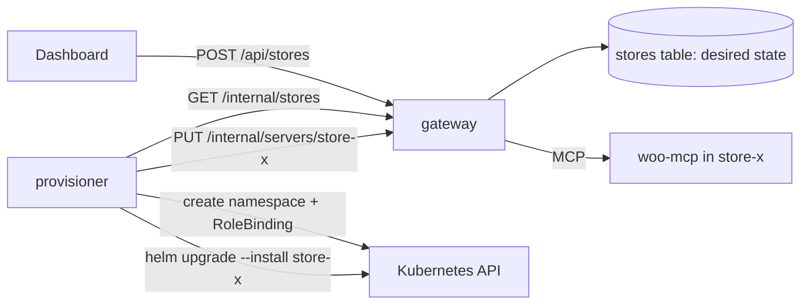

# System design and tradeoffs

## Architecture choices

| Decision                                                                                     | Why                                                                                                                                                                    | Rejected                                                                                                         |
| -------------------------------------------------------------------------------------------- | ---------------------------------------------------------------------------------------------------------------------------------------------------------------------- | ---------------------------------------------------------------------------------------------------------------- |
| **k3d locally, k3s on the VPS**                                                              | Same distribution in both places: same Traefik, same `local-path` storage, same embedded NetworkPolicy controller. "Values only" holds in practice, not only on paper. | kind/minikube: a different ingress controller and storage class from production.                                 |
| **Traefik Ingress** (k3s default), standard `networking.k8s.io/v1` objects                   | Ships with k3s and is maintained. The Ingress objects stay portable.                                                                                                   | ingress-nginx (retired).                                                                                         |
| **Own charts on official images** (`wordpress`, `mariadb`, `postgres`, `nginx-unprivileged`) | Small enough to explain line by line. No dependency on vendor chart conventions.                                                                                       | Bitnami charts and images (paywalled).                                                                           |
| **Three charts, three namespaces** (`store`, `platform`, `demo-upstreams`)                   | Each concern is an independently upgradable release. The store chart can be installed once per namespace. NetworkPolicies are written per namespace.                   | One umbrella chart: one namespace, one blast radius.                                                             |
| **One public host for dashboard, `/api` and `/mcp`**                                         | Same origin, so no CORS. Session cookies can be `SameSite=Lax`.                                                                                                        | Separate API host.                                                                                               |
| **woo-mcp uses the WooCommerce REST API**                                                    | Versioned, documented, and runs WooCommerce's own validation and hooks. It works over the network, so woo-mcp is an ordinary Deployment.                               | WP-CLI (needs exec into the WordPress pod or a shared volume); direct SQL (bypasses WooCommerce business logic). |
| **Tool names are always `<server>__<tool>`**                                                 | Deterministic and collision-proof, and a name never changes when another server is added.                                                                              | Prefix only on collision: names change under connected clients.                                                  |
| **Stateful gateway sessions**                                                                | Lets the gateway push `tools/list_changed` when servers are disabled or go down.                                                                                       | Stateless: scales trivially but cannot notify clients.                                                           |
| **Chat agent is an MCP client of the gateway's own `/mcp`**                                  | Same authentication, permissions and audit path as external clients. Proves that nothing else talks to upstreams.                                                      | In-process function calls that bypass the protocol path.                                                         |
| **Postgres for gateway state, plain SQL migrations**                                         | Transactions, constraints and an advisory lock for migrations, with no ORM to explain.                                                                                 | SQLite (single writer, file on a PVC); an ORM.                                                                   |

## Store on Kubernetes

`charts/store` deploys one WooCommerce store into its own namespace. Resource names are fixed (`mariadb`, `wordpress`, `woo-rest`) and the namespace provides uniqueness, so every store has the same in-cluster DNS shape (`wordpress.<namespace>.svc`). Two releases of the chart cannot share a namespace; that is intended.

| Resource                           | Kind                                        | Notes                                                                                                                                                                                              |
| ---------------------------------- | ------------------------------------------- | -------------------------------------------------------------------------------------------------------------------------------------------------------------------------------------------------- |
| `mariadb`                          | StatefulSet + headless Service              | Data on a `volumeClaimTemplates` PVC. Probes use the image's `healthcheck.sh` with its own `healthcheck@localhost` user, so no root password is needed for probing.                                |
| `wordpress`                        | Deployment + Service + Ingress              | `/var/www/html` (core, plugins, uploads, `wp-config.php`) on a RWO PVC. `strategy: Recreate`, because a rolling update would start a second pod that cannot attach the RWO volume on another node. |
| `bootstrap`                        | Job (Helm `post-install,post-upgrade` hook) | WP-CLI makes the store shop-ready. Every step checks state first, so the Job runs safely on every upgrade.                                                                                         |
| `mariadb`, `wordpress`, `woo-rest` | Secrets                                     | Generated by Helm on first install and read back with `lookup` on upgrades.                                                                                                                        |

### Probes

- MariaDB: readiness = connect + InnoDB initialised; liveness = connect only; a startup probe covers first-time initialisation.
- WordPress: readiness = `GET /wp-login.php`. It executes PHP and opens a DB connection, so the pod leaves the Service when MariaDB is down. 3xx counts as success, so it also passes before installation, when the page redirects to the installer. Liveness is TCP only: a database outage must not restart Apache.
- The bootstrap Job has no probes (Jobs run to completion). It has resource requests/limits, a wait deadline with a clear error, `backoffLimit` and `activeDeadlineSeconds`.

### Bootstrap

The Job waits for `wp-config.php` and a working DB connection, then idempotently:

1. Installs WordPress core.
2. Installs a pinned WooCommerce version and activates it. A version bump in values reinstalls that version on the next upgrade.
3. Sets `/%postname%/` permalinks and writes `.htaccess`, which `/wp-json/` routes require.
4. Sets timezone, country and currency. Disables WooCommerce's "coming soon" mode, which new stores enable by default and which hides the shop from logged-out shoppers. Enables Cash on Delivery.
5. Creates the WooCommerce pages and the sample products. Products are matched by SKU, so reruns create no duplicates.
6. Registers the Helm-generated REST API key for the MCP server.

### Persistence and uninstall

Secrets and the WordPress PVC carry `helm.sh/resource-policy: keep`. The MariaDB PVC comes from `volumeClaimTemplates`, so Helm does not own it and it survives `helm uninstall` anyway. Keeping the Secrets matters: a regenerated DB password would no longer match the data already in MariaDB. `helm uninstall` followed by `helm install` therefore brings the store back with its products and orders. A full wipe is `kubectl delete namespace store`.

### Domain and URLs

The public URL comes from values (`store.host` + `global.domain`) and is written into `wp-config.php` as `WP_HOME`/`WP_SITEURL`. Changing the domain between local and production is a values change; no database search-and-replace is needed. Locally the domain is `127.0.0.1.nip.io`: a wildcard DNS name that resolves to `127.0.0.1`, which k3d maps to Traefik on port 80, with no `/etc/hosts` edits needed. `/etc/hosts` entries are the fallback when there is no internet DNS.

## WooCommerce REST access from inside the cluster

The MCP server calls the WooCommerce REST API (`/wp-json/wc/v3`) through the in-cluster Service. WordPress serves these requests on the internal hostname without redirecting to the public host.

Authentication uses WooCommerce consumer keys. Over plain HTTP, WooCommerce rejects HTTP Basic auth and accepts only OAuth 1.0a one-legged signatures (HMAC-SHA256). This is the mode we use, for three reasons:

- In-cluster traffic is plain HTTP, and TLS terminates at the Ingress.
- The consumer secret never goes over the network. Requests carry only a signature, a timestamp and a single-use nonce, and WooCommerce rejects replays within its 15-minute window.
- The alternative, sending `X-Forwarded-Proto: https` so that Basic auth is accepted, only works because the WordPress image trusts that header from any client. Building on that would depend on a spoofable header.

The signature covers the site's **home URL**, not the hostname the request was sent to. The client sends requests to `wordpress.<namespace>.svc` but signs them for the public store URL.

## WooCommerce MCP server

`apps/woo-mcp` is an MCP server over Streamable HTTP. It exposes six tools: `get_store_info`, `list_products`, `create_product`, `list_orders`, `get_order` and `update_order_status`. It runs in the store's namespace behind a ClusterIP Service. It has no Ingress and requires a bearer token that only the gateway holds.

- **Stateless transport.** Each POST gets a fresh MCP server and transport. woo-mcp keeps no per-client state, so any replica can serve any request and the gateway needs no session affinity to it.
- **"Today" is the store's day.** The chart sets the store timezone. `get_store_info` returns the current date and time in that timezone, and `list_orders(date=YYYY-MM-DD)` covers that whole local day. The model never has to work out timezone offsets.
- **Errors a model can act on.** Store failures become `isError` tool results with one line of text ("Order 123 not found", "Store did not respond within 15s"). Raw WooCommerce responses and stack traces never reach the client. Redirects from the store are refused, not followed.
- **Readiness checks the process only.** When the store is down, woo-mcp stays in service and answers with a clear error instead of disappearing. Store reachability is reported separately (`/store-health`). The gateway's own health checks track whether woo-mcp itself is reachable.
- **Host-header allowlist.** The server binds all interfaces in the pod but accepts only its in-cluster Service names in the `Host` header. Kubelet probes send `Host: localhost` explicitly.

## Request flow

A `tools/call` for `woo__list_orders` from an MCP client:

1. The client sends `POST https://app.<domain>/mcp` with `Authorization: Bearer <API key>` and the `Mcp-Session-Id` it received on `initialize`.
2. Traefik matches the host and the `/mcp` path and forwards the request to the `gateway` Service in `platform`.
3. The gateway authenticates the key on every request. The session must belong to the same key that opened it; otherwise the gateway answers as if the session did not exist.
4. The gateway splits the tool name on the first `__` into server slug `woo` and tool `list_orders`. It checks that the server is enabled and that the tool is in its cached tool list.
5. The gateway's long-lived MCP client for `woo` sends `tools/call list_orders` to `http://woo-mcp.store.svc:3000/mcp` with woo-mcp's bearer token, under a per-call timeout.
6. woo-mcp validates the arguments, then calls `GET http://wordpress/wp-json/wc/v3/orders` with an OAuth 1.0a signature.
7. WooCommerce queries MariaDB and returns JSON. woo-mcp reduces it to the contract shape and returns `content` plus `structuredContent`.
8. The gateway records the call (user, server, tool, outcome, duration) and returns the result unchanged.

Credentials at each hop: the client's API key ends at the gateway. The gateway's token for woo-mcp ends at woo-mcp. woo-mcp's WooCommerce key is never sent; only signatures are. No credential is forwarded beyond the hop it was issued for.

## Gateway: aggregation, routing and failure handling

- **One client per upstream.** The gateway holds one MCP client per enabled upstream server. It caches each server's tool list (refreshed when the upstream sends `tools/list_changed`) and runs a health check every few seconds (`ping`, or reconnect when disconnected). The status shown to admins is `connected`, `unreachable` or `disabled`.
- **Listing never touches the network.** `tools/list` is served from the cache of connected servers. A dead or slow upstream cannot delay or break listing.
- **Name collisions.** Every tool is exposed as `<server slug>__<tool name>`, always, not only when a collision exists, so names never change when servers are added. Slugs match `^[a-z][a-z0-9-]{1,30}$` and cannot contain `__`. The name is split on the first `__`, so upstream tool names may themselves contain `__`. Descriptions are prefixed with `[<server name>]`.
- **Timeouts and failures.**
  - Every upstream call has a timeout. A timeout returns an `isError` result such as "WooCommerce did not respond within 30s".
  - An unreachable server returns "<server> is unreachable" and triggers an immediate re-check.
  - Calls to other servers are unaffected; tested with a deliberately slow upstream next to a healthy one.
- **Tools disappear when a server goes away.** The gateway's MCP endpoint is stateful (one session per client), so it can push `notifications/tools/list_changed` to every connected client when a server is disabled, removed, goes down or comes back. Clients then re-list and the tools are gone. A call that names a disabled server's tool is rejected even if a client cached the old list.
- **Credentials stay in the gateway.** Each upstream's static credential (bearer token or a named header) is attached only to that upstream's requests. The API returns server status and tool names, never URLs or credentials. Redirects from upstreams are refused, so an upstream cannot bounce the gateway, and its credential, to another host.

## Kubernetes layout

| Workload   | Kind                         | Requests / limits       | Readiness                                       | Liveness                   |
| ---------- | ---------------------------- | ----------------------- | ----------------------------------------------- | -------------------------- |
| MariaDB    | StatefulSet, PVC             | 100m/256Mi, 1 CPU/1Gi   | `healthcheck.sh --connect --innodb_initialized` | `healthcheck.sh --connect` |
| WordPress  | Deployment (`Recreate`), PVC | 100m/256Mi, 1 CPU/768Mi | `GET /wp-login.php`                             | TCP :80                    |
| bootstrap  | Job (Helm hook)              | 100m/256Mi, 1 CPU/768Mi | n/a (runs to completion)                        | n/a                        |
| woo-mcp    | Deployment                   | 50m/96Mi, 500m/256Mi    | `GET /healthz`                                  | `GET /healthz`             |
| gateway    | Deployment                   | 50m/128Mi, 500m/384Mi   | `GET /readyz` (database reachable)              | `GET /healthz`             |
| dashboard  | Deployment                   | 10m/16Mi, 200m/64Mi     | `GET /healthz`                                  | `GET /healthz`             |
| Postgres   | StatefulSet, PVC             | 50m/128Mi, 1 CPU/512Mi  | `pg_isready`                                    | `pg_isready`               |
| everything | Deployment                   | 25m/96Mi, 300m/256Mi    | TCP :3001                                       | TCP :3001                  |

Readiness never depends on another service's health. woo-mcp stays ready when WordPress is down and answers "Store is unreachable". The gateway stays ready when an upstream dies and marks only that server as unreachable. A downstream outage therefore surfaces as a clear error, not as a missing endpoint, and a fresh install cannot deadlock on hook ordering.

**Public versus internal.**

- Public, through Ingress: only `store.<domain>` (WordPress) and `app.<domain>` (dashboard, `/api`, `/mcp`).
- Internal: everything else uses ClusterIP Services and is fenced by NetworkPolicies.
  - Every application namespace denies all ingress and egress by default and then allows exactly these paths: Traefik → WordPress, dashboard and gateway; WordPress → MariaDB; woo-mcp → WordPress; gateway → Postgres, the upstream namespaces and public addresses.
  - woo-mcp additionally requires the gateway's bearer token.
- `scripts/e2e.sh` proves isolation with connection probes and positive controls. For example, woo-mcp is unreachable from `default` and from other pods in `store`, the gateway cannot reach the Kubernetes API, and woo-mcp has no internet egress.

**Secrets.**

- Every credential is a Kubernetes Secret, generated by Helm on first install (`randAlphaNum`), read back with `lookup` on upgrade, and kept on uninstall (`helm.sh/resource-policy: keep`). The volumes outlive releases, and the credentials baked into them must too.
- The gateway gets woo-mcp's token by copying it at install time from `store/woo-mcp`, because pods cannot reference Secrets across namespaces.
- No credential appears in values files, the repository, or command lines.

## Identity, access and audit

- **Dashboard.** Email and password (scrypt), with an httpOnly `SameSite=Lax` session cookie (`Secure` over TLS). Members join through single-use invite links. There are two roles, `admin` and `member`.
- **API keys.** `urk_<id>_<secret>` with a 256-bit secret. Stored as key id plus SHA-256(secret), shown once, revocable by the owner or an admin. A fast hash is correct for high-entropy random secrets; a slow KDF would only add latency to every MCP request.
- **Checked on every MCP request.** A revoked key fails on its next call, even inside an open session. Sessions are bound to the key that opened them.
- **Audit log.** One row per tool call: user, key, `via` (mcp or chat), server, tool, duration, and an outcome of `ok`, `tool_error`, `timeout`, `unreachable`, `unknown_tool`, `denied` or `auth_rejected`, with error text. Use of a revoked key is attributed to its owner. Members see their own rows; admins see all rows.
- **Tool permissions.** Deny rules per role, with `*` wildcards. The default allows everything. A denied tool is hidden from that role's `tools/list` and rejected when called, for external clients and the chat agent alike.
- **Upstream credentials.** AES-256-GCM in Postgres, with the key in a Secret. Write-only in the API, decrypted only to build that upstream's client.

## Chat agent

`POST /api/chat` (dashboard session) runs this loop and streams each step to the browser as server-sent events:

1. Mint a 5-minute token for the logged-in user (HMAC-signed `{uid, exp}`).
2. Connect an MCP client to the gateway's own `/mcp` with that token, and call `tools/list`. The list is fresh every turn, so the agent sees exactly that user's permitted, currently enabled tools.
3. Send the conversation and the tool declarations to the model. The provider is pluggable behind a two-method interface: Gemini through `@google/genai` (production default), or any OpenAI-compatible endpoint (locally: OpenRouter). Each function call the model returns is executed with `tools/call`, and the result goes back to the model. This repeats until the model answers or `llm.maxSteps` (8) is reached.
4. Stream `tool_call`, `tool_result`, `message` and `error` events. The UI renders each tool call as a card with arguments, result and duration.

Every call made by the agent goes through the same authentication, permission checks and audit path as an external client, so it appears in the audit log under the user with `via = chat`. The system prompt tells the model to treat tool descriptions and results as untrusted data. The step cap bounds runaway loops.

## Multi-store provisioning

- **Desired state and a reconcile loop.**
  - The gateway records what should exist: a `stores` row with `desired=present|absent`.
  - The provisioner polls the gateway's internal API every 5 seconds and drives each store toward its desired state, up to 3 at a time.
  - Every step is idempotent: create the namespace, bind the role, `helm upgrade --install`, read the woo-mcp token, register the upstream, report `ready`.
  - If the provisioner restarts mid-way, the next pod picks up the `provisioning` rows and completes them, or marks them `failed` with Helm's error as the reason.
  - Helm's `--wait --timeout` is the provisioning timeout.
  - Creating an existing store returns it, and creating a failed one re-queues it, so creating is safe to retry.
- **Separation of privileges.** The gateway owns the database and has no Kubernetes permissions. The provisioner has Kubernetes permissions and no database access. It talks to the gateway through `/internal`, which:
  - is not routed by the Ingress,
  - accepts connections only from the provisioner pod (NetworkPolicy),
  - requires a shared token from a Secret.
- **Least-privilege RBAC.**
  - Cluster-wide, the provisioner may only create and delete namespaces and RoleBindings, and `bind` the `urumi-store-manager` ClusterRole.
  - It gets the permissions to manage a store (Secrets, workloads, PVCs, Ingress, NetworkPolicies, quota) only through a RoleBinding it creates inside each `store-<name>` namespace. So it can never read the `platform` Secrets.
  - A `ValidatingAdmissionPolicy` adds a check RBAC cannot express. The provisioner's namespace and RoleBinding writes must target `store-*` names, carry the `urumi.io/store` label, and bind only the store role. This prevents it from binding itself into `platform` or `kube-system`. `scripts/e2e-stores.sh` verifies each of these limits.
- **Isolation.** Each store runs the same chart with the same NetworkPolicies: woo-mcp reaches only its own WordPress, and MariaDB accepts only its own pods. The gateway's egress allows namespaces labelled `urumi.io/store`.
- **Guardrails.** Each namespace gets a ResourceQuota (CPU, memory, storage, PVC, pod and service counts) and a LimitRange. Each user has a store limit, enforced in a transaction with a per-user advisory lock, so parallel requests cannot exceed it.
- **Teardown.** Deregister the upstream first, so its tools vanish from clients before the backend does. Then `helm uninstall`, then delete the namespace, which removes the PVCs, the kept Secrets and the RoleBinding. The row is purged once the namespace is gone.

## What changes for production

All differences are Helm values; the templates are the same.

| Concern       | Local (`values-local.yaml`)                                 | VPS (`values-prod.yaml` + `--set`)                                                                                                                                                                 |
| ------------- | ----------------------------------------------------------- | -------------------------------------------------------------------------------------------------------------------------------------------------------------------------------------------------- |
| DNS           | `*.127.0.0.1.nip.io` resolves to localhost                  | `*.<domain>` A record to the VM, or `<ip>.sslip.io`                                                                                                                                                |
| Ingress       | Traefik over HTTP                                           | Traefik with TLS from cert-manager (`letsencrypt-prod`, HTTP-01). The Ingress gets a `cert-manager.io/cluster-issuer` annotation and a `tls` block. URLs and cookies switch to https and `Secure`. |
| Storage class | `local-path`, small PVCs                                    | `local-path` on single-node k3s, larger PVCs. On a managed cluster, set `global.storageClass` to the provider's CSI class.                                                                         |
| Images        | built and imported into k3d                                 | multi-arch images in a registry (`make push`), repository set with `--set`                                                                                                                         |
| Secrets       | generated in-cluster; LLM key from a gitignored values file | same. Production values come from a separate gitignored file or `--set`; a sealed-secrets or external-secrets controller is the next step for a team.                                              |
| Resources     | small                                                       | larger requests and limits                                                                                                                                                                         |

One production detail: WooCommerce verifies OAuth signatures against its home URL using the scheme of the incoming request. TLS ends at Traefik and in-cluster requests are plain HTTP, so woo-mcp signs for `http://<store host>` even when the site is served over HTTPS.

**Upgrades and rollback.**

- Image tags are content hashes of each component's sources, so `helm upgrade` restarts only what changed.
- Store: the bootstrap Job runs on `post-install`, `post-upgrade` and `post-rollback`. A rollback restores Kubernetes objects but not database state, so the Job re-applies the rolled-back values (WooCommerce version, title, settings) to WordPress.
- Gateway: migrations are additive and run under an advisory lock, so a rollback to an older image runs against the newer schema.
- `helm rollback` never deletes PVC data.

**Scaling the gateway.** It runs one replica because MCP sessions and the in-memory rate limiter live in the process. Running several replicas needs session affinity on `Mcp-Session-Id` at the Ingress, or a shared session store, plus a shared rate limiter. Upstream clients and the tool cache are per replica and need no coordination.

## Observability

- **`/metrics`, Prometheus text format, no extra dependency:**
  - `urumi_gateway_tool_calls_total{server, outcome, via}`
  - `urumi_gateway_tool_call_duration_seconds` (histogram per server, 50 ms to 30 s buckets)
  - `urumi_gateway_upstream_up{server, status}` and `urumi_gateway_upstream_tools{server}`
  - `urumi_gateway_mcp_sessions`
  - `urumi_gateway_uptime_seconds`

  The endpoint is not routed by the Ingress, since `/` on the app host goes to the dashboard, and the gateway NetworkPolicy admits only Traefik and the provisioner. Read it with `kubectl port-forward`, or allow a Prometheus scraper's namespace in the policy.

- **Per-server stats** for admins on the Servers page (`GET /api/servers/stats?hours=N`), computed from the audit log so they survive restarts:
  - calls,
  - upstream error rate (tool errors, timeouts, unreachable),
  - calls the gateway refused (denied, unknown tool),
  - p50/p95 latency.
- **Failure reasons.** Node reports network failures as "fetch failed" with the real cause nested in `err.cause`, sometimes one error per attempted address. The gateway walks that chain and reports a reason an admin can act on: connection refused, DNS failure, connection reset, TLS certificate error, refused redirect, credential rejected (401/403), wrong path (404), upstream server error (5xx), timeout, or blocked by the SSRF guard. The reason appears on the server card, and failed calls carry their error text in the audit log.

## Testing

- **Unit and integration tests** (`make check`):
  - woo-mcp: OAuth signature against a known-good vector, the REST client's error mapping, and protocol-level tests over HTTP.
  - gateway: runs against a real Postgres and real in-process MCP servers that are slow, dead or have colliding names. Covers auth, roles, revocation inside a session, session binding, audit, encrypted credentials, the SSRF guard, timeouts, `list_changed`, tool permissions, and the chat loop with a scripted model.
- **End to end** (`make e2e`), against the running cluster:
  - The store checkout with COD.
  - The two-user gateway flow: invite, own key, all servers' tools, orders today, routing, disable/enable, kill-pod and recovery, permissions, revoke, audit attribution.
  - Network isolation and egress checks.
- **From scratch:** `make cluster-down && make cluster-up && make deploy-local && make e2e` reproduces everything with no manual steps.
