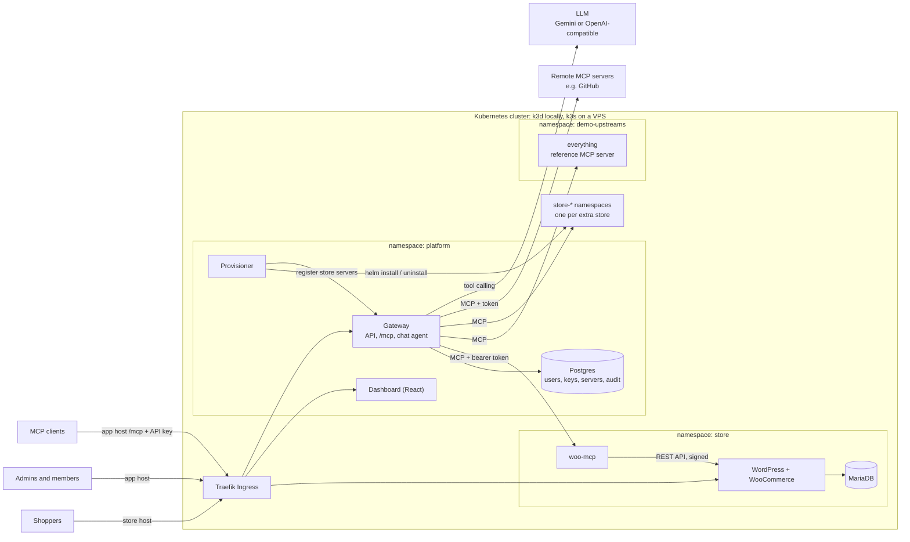
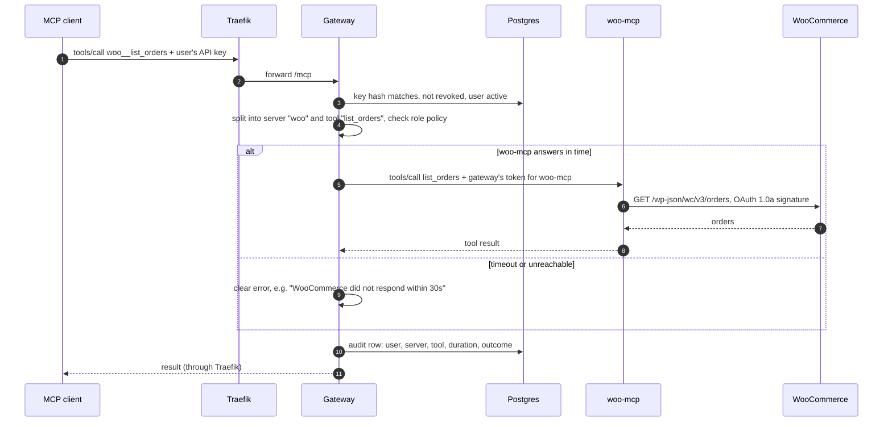
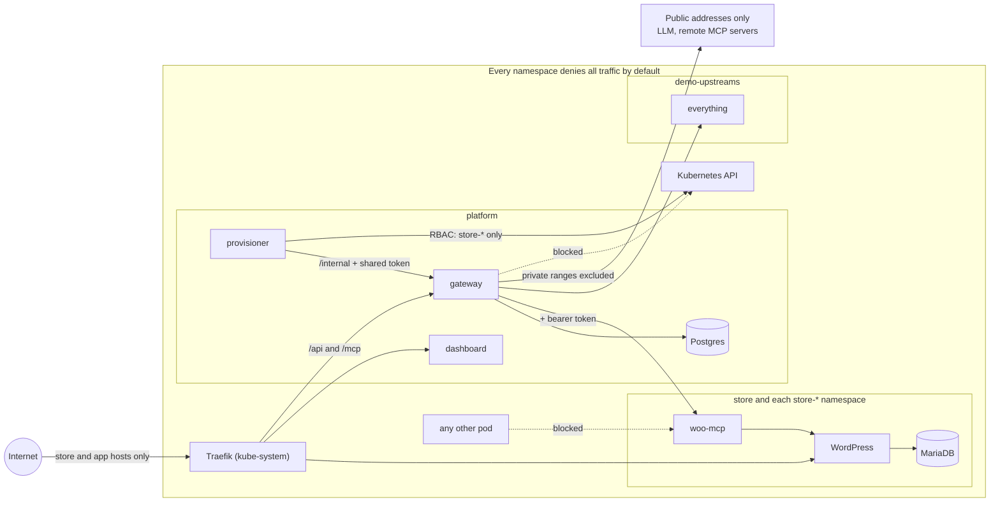
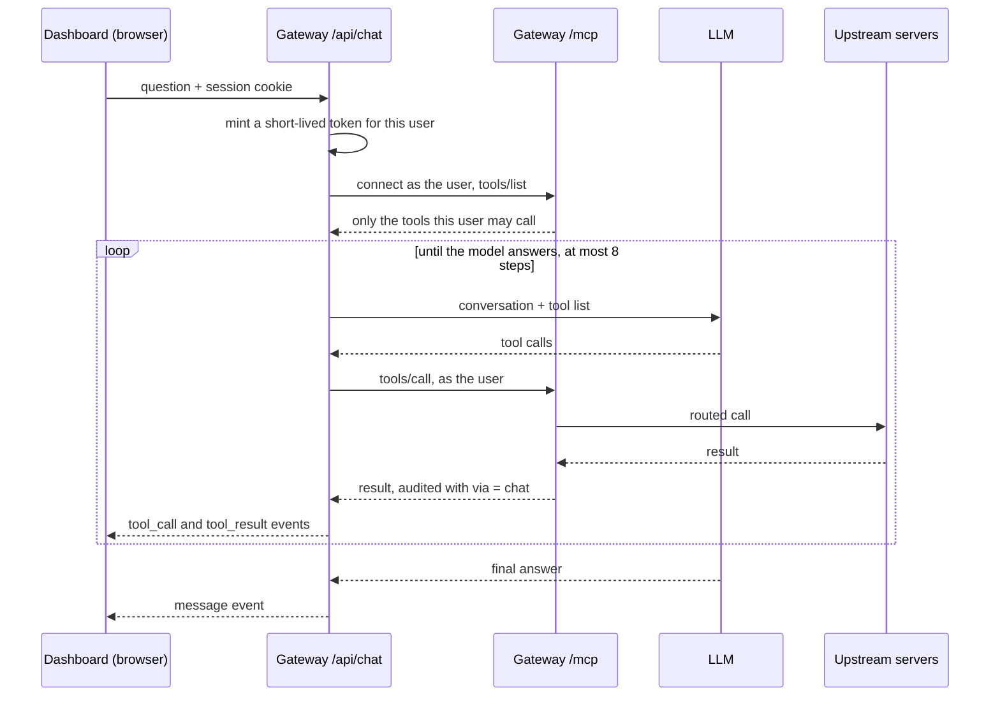
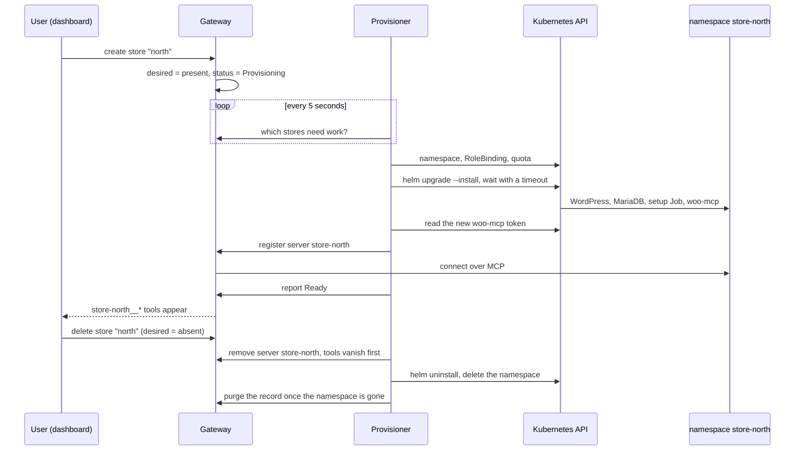

# System design and tradeoffs

This note explains how the system is built and why. Each section starts with the short version. The details that follow are for readers who want to check the mechanism.

- [The system at a glance](#the-system-at-a-glance)
- [Architecture choices](#architecture-choices)
- [Store on Kubernetes](#store-on-kubernetes) and [how woo-mcp reaches it](#woocommerce-rest-access-from-inside-the-cluster)
- [Request flow](#request-flow): one tool call, end to end
- [Gateway: aggregation, routing and failure handling](#gateway-aggregation-routing-and-failure-handling)
- [What holds under failure](#what-holds-under-failure)
- [Kubernetes layout](#kubernetes-layout): probes, limits, public versus internal, secrets
- [Identity, access and audit](#identity-access-and-audit)
- [Chat agent](#chat-agent)
- [Multi-store provisioning](#multi-store-provisioning)
- [What changes for production](#what-changes-for-production)
- [Observability](#observability) and [Testing](#testing)

## The system at a glance

Three Helm charts install into three namespaces. The **store** chart holds the shop and its MCP server. The **platform** chart holds everything the team uses: the gateway, the dashboard, their database and the store provisioner. The **demo-upstreams** chart holds a third-party MCP server for the demo. Traefik, the ingress controller that ships with k3s, is the only way in from outside.

| Namespace        | Component           | Responsibility                                                                                                                              |
| ---------------- | ------------------- | ------------------------------------------------------------------------------------------------------------------------------------------- |
| `store`          | WordPress + MariaDB | The shop. Database and `wp-content` on volumes. A setup Job installs WooCommerce, enables Cash on Delivery and adds products.               |
| `store`          | `woo-mcp`           | MCP server for products and orders. Internal only; only the gateway can reach it.                                                           |
| `platform`       | `gateway`           | Dashboard API, server registry, the aggregated `/mcp` endpoint, audit log, tool permissions, chat agent.                                    |
| `platform`       | `dashboard`         | React app served by nginx.                                                                                                                  |
| `platform`       | Postgres            | Users, API keys, servers (credentials encrypted), audit log, stores.                                                                        |
| `platform`       | `provisioner`       | Installs and deletes extra stores, each as Helm release `store-<name>` in its own namespace. The only component with Kubernetes API access. |
| `demo-upstreams` | `everything`        | The MCP reference server, registered twice to show how tool-name collisions are handled.                                                    |

## Architecture choices

| Decision                                                        | Why                                                                                                                                                | Rejected                                                                                               |
| --------------------------------------------------------------- | -------------------------------------------------------------------------------------------------------------------------------------------------- | ------------------------------------------------------------------------------------------------------ |
| **k3d locally, k3s on the VPS**                                 | The same distribution in both places: same Traefik, same `local-path` storage, same NetworkPolicy controller. "Values only" holds in practice.     | kind or minikube: a different ingress controller and storage class from production.                    |
| **Traefik Ingress**, standard `networking.k8s.io/v1` objects    | Ships with k3s and is maintained. The Ingress objects stay portable.                                                                               | ingress-nginx (retired).                                                                               |
| **Own charts on official images**                               | `wordpress`, `mariadb`, `postgres`, `nginx-unprivileged`. Small enough to explain line by line, with no vendor chart conventions.                  | Bitnami charts and images (now paywalled).                                                             |
| **Three charts, three namespaces**                              | Each part upgrades on its own. The store chart installs once per namespace, which the multi-store bonus reuses. NetworkPolicies are per namespace. | One umbrella chart: one namespace, one blast radius.                                                   |
| **One public host for dashboard, `/api` and `/mcp`**            | Same origin: no CORS, and the session cookie can be `SameSite=Lax`.                                                                                | A separate API host.                                                                                   |
| **woo-mcp uses the WooCommerce REST API**                       | Versioned and documented, and it runs WooCommerce's own validation and hooks. It works over the network, so woo-mcp is an ordinary Deployment.     | WP-CLI (needs exec into the WordPress pod or a shared volume); direct SQL (skips WooCommerce's logic). |
| **Tool names are always `<server>__<tool>`**                    | Collision-proof, and a name never changes when another server is added.                                                                            | Prefix only on collision: names would change under connected clients.                                  |
| **Stateful gateway sessions**                                   | The gateway can push `tools/list_changed` when a server is disabled or goes down.                                                                  | Stateless: scales trivially, but cannot notify clients.                                                |
| **The chat agent is an MCP client of the gateway's own `/mcp`** | Same authentication, permissions and audit path as an external client. Nothing else talks to upstreams.                                            | In-process function calls that bypass that path.                                                       |
| **Postgres, plain SQL migrations**                              | Transactions, constraints and an advisory lock for migrations, with no ORM to explain.                                                             | SQLite (one writer, a file on a volume); an ORM.                                                       |

## Store on Kubernetes

The store is three workloads: a database, WordPress, and a one-off setup Job. Data lives on volumes, so pods can restart or be replaced without losing products or orders.

`charts/store` deploys one store into its own namespace. Resource names are fixed (`mariadb`, `wordpress`, `woo-rest`) and the namespace makes them unique. Every store therefore has the same in-cluster address shape, `wordpress.<namespace>.svc`. Two releases of the chart cannot share a namespace, by design.

| Resource                           | Kind                                                      | Notes                                                                                                                                                                                                        |
| ---------------------------------- | --------------------------------------------------------- | ------------------------------------------------------------------------------------------------------------------------------------------------------------------------------------------------------------ |
| `mariadb`                          | StatefulSet + headless Service                            | Data on a `volumeClaimTemplates` volume. Probes use the image's `healthcheck.sh` with its own `healthcheck@localhost` user, so probing needs no root password.                                               |
| `wordpress`                        | Deployment + Service + Ingress                            | `/var/www/html` (core, plugins, uploads, `wp-config.php`) on a ReadWriteOnce volume. `strategy: Recreate`, because a rolling update would start a second pod that cannot attach that volume on another node. |
| `bootstrap`                        | Job (Helm `post-install,post-upgrade,post-rollback` hook) | WP-CLI makes the store ready to sell. Each step checks state first, so the Job runs safely on every upgrade.                                                                                                 |
| `mariadb`, `wordpress`, `woo-rest` | Secrets                                                   | Generated by Helm on first install and read back with `lookup` on upgrades.                                                                                                                                  |

### Probes

- **MariaDB.** Ready when it accepts connections and InnoDB is initialised. Live when it accepts connections. A startup probe covers first-time initialisation.
- **WordPress.** Ready when `GET /wp-login.php` succeeds. That page runs PHP and opens a database connection, so the pod leaves the Service when MariaDB is down. A redirect counts as success, so the probe also passes before installation. Liveness is a TCP check only: a database outage must not restart Apache.
- **Setup Job.** No probes, because Jobs run to completion. It has requests and limits, a wait deadline with a clear error, `backoffLimit` and `activeDeadlineSeconds`.

### Setup Job

The Job waits for `wp-config.php` and a working database connection. Then, skipping anything already done, it:

1. Installs WordPress core.
2. Installs and activates a pinned WooCommerce version. Changing the version in values reinstalls it on the next upgrade.
3. Sets `/%postname%/` permalinks and writes `.htaccess`, which the `/wp-json/` routes need.
4. Sets timezone, country and currency, and enables Cash on Delivery. It also turns off WooCommerce's "coming soon" mode, which new stores enable by default and which hides the shop from logged-out shoppers.
5. Creates the WooCommerce pages and the sample products. Products are matched by SKU, so reruns create no duplicates.
6. Registers the Helm-generated REST API key that woo-mcp uses.

### Persistence and uninstall

Secrets and the WordPress volume carry `helm.sh/resource-policy: keep`. The MariaDB volume comes from `volumeClaimTemplates`, so Helm does not own it and it survives `helm uninstall` anyway. Keeping the Secrets matters: a regenerated database password would no longer match the data already in MariaDB. `helm uninstall` followed by `helm install` brings the store back with its products and orders. A full wipe is `kubectl delete namespace store`.

### Domain and URLs

The public URL comes from values (`store.host` + `global.domain`) and is written into `wp-config.php` as `WP_HOME` and `WP_SITEURL`. Changing the domain between local and production is a values change, with no database search-and-replace. Locally the domain is `127.0.0.1.nip.io`, a wildcard DNS name that resolves to `127.0.0.1`, which k3d maps to Traefik on port 80. `/etc/hosts` entries are the fallback without internet DNS.

## WooCommerce REST access from inside the cluster

woo-mcp calls WooCommerce over the internal network and signs each request instead of sending its secret.

The MCP server calls the WooCommerce REST API (`/wp-json/wc/v3`) through the in-cluster Service. WordPress serves these requests on the internal hostname without redirecting to the public one.

Authentication uses WooCommerce consumer keys. Over plain HTTP, WooCommerce rejects HTTP Basic auth and accepts only OAuth 1.0a one-legged signatures (HMAC-SHA256). This is the mode woo-mcp uses, for three reasons:

- In-cluster traffic is plain HTTP; TLS ends at the Ingress.
- The consumer secret never crosses the network. A request carries only a signature, a timestamp and a single-use nonce, and WooCommerce rejects replays within its 15-minute window.
- The alternative is to send `X-Forwarded-Proto: https` so that Basic auth is accepted. That works only because the WordPress image trusts the header from any client, and it would build on a spoofable header.

The signature covers the site's **home URL**, not the hostname the request goes to. woo-mcp sends requests to `wordpress.<namespace>.svc` but signs them for the public store URL.

## WooCommerce MCP server

woo-mcp turns WooCommerce into six tools a model can use, and returns errors a model can act on.

`apps/woo-mcp` speaks MCP over Streamable HTTP. Its tools are `get_store_info`, `list_products`, `create_product`, `list_orders`, `get_order` and `update_order_status`. It runs in the store's namespace behind an internal (ClusterIP) Service, has no Ingress, and requires a bearer token that only the gateway holds.

- **Stateless.** Each request gets a fresh MCP server and transport. woo-mcp keeps no per-client state, so any replica can answer any request.
- **"Today" is the store's day.** The chart sets the store timezone. `get_store_info` returns the current date and time in that timezone, and `list_orders(date=YYYY-MM-DD)` covers that whole local day. The model never works out timezone offsets.
- **Errors a model can act on.** Store failures become `isError` tool results with one line of text, such as "Order 123 not found" or "Store did not respond within 15s". Raw WooCommerce responses and stack traces never reach the client. Redirects from the store are refused.
- **Readiness checks the process only.** When the store is down, woo-mcp stays in service and answers with a clear error instead of disappearing. Store reachability is reported separately at `/store-health`.
- **Host-header allowlist.** The server listens on all interfaces in the pod but accepts only its in-cluster Service names in the `Host` header. Kubelet probes send `Host: localhost` explicitly.

## Request flow

Here is a `tools/call` for `woo__list_orders` from an external client. Each hop checks its own credential, and no credential travels further than the hop it was issued for.

1. The client sends `POST https://app.<domain>/mcp` with `Authorization: Bearer <API key>` and the `Mcp-Session-Id` it received on `initialize`.
2. Traefik matches the host and the `/mcp` path and forwards the request to the `gateway` Service.
3. The gateway checks the key on every request. The session must belong to the key that opened it; otherwise the gateway answers as if the session did not exist.
4. The gateway splits the tool name on the first `__` into server `woo` and tool `list_orders`. It checks that the server is enabled, that the tool is in its cached tool list, and that the caller's role may use it.
5. The gateway's long-lived MCP client for `woo` sends `tools/call list_orders` to `http://woo-mcp.store.svc:3000/mcp` with woo-mcp's bearer token, under a per-call timeout.
6. woo-mcp validates the arguments and calls `GET http://wordpress/wp-json/wc/v3/orders` with an OAuth 1.0a signature.
7. WooCommerce queries MariaDB. woo-mcp reduces the JSON to the tool's documented shape and returns `content` plus `structuredContent`.
8. The gateway writes the audit row (user, server, tool, outcome, duration), then returns the result unchanged.

**Credentials at each hop.** The client's API key stops at the gateway. The gateway's token for woo-mcp stops at woo-mcp. woo-mcp's WooCommerce secret is never sent at all, only signatures.

## Gateway: aggregation, routing and failure handling

The gateway keeps one open connection to each upstream server and remembers each server's tool list. Listing tools reads that memory, so a slow or dead server can never hold up the list. Calls go to exactly one server and always end in a clear answer, even when that server is down.

- **One client per upstream.** The gateway holds one MCP client per enabled server. It caches each server's tool list, refreshes it when the server sends `tools/list_changed`, and runs a health check every few seconds (`ping`, or a reconnect when disconnected). Admins see the status as `connected`, `unreachable` or `disabled`.
- **Listing never touches the network.** `tools/list` is served from the cache of connected servers.
- **Name collisions.** Every tool is exposed as `<server slug>__<tool name>`, always, not only on a collision, so names never change when servers are added. Slugs match `^[a-z][a-z0-9-]{1,30}$` and cannot contain `__`. The name is split on the first `__`, so upstream tool names may contain `__` themselves. Descriptions are prefixed with `[<server name>]`.
- **Timeouts and failures.**
  - Every upstream call has a timeout. A timeout returns an `isError` result such as "WooCommerce did not respond within 30s".
  - An unreachable server returns "<server> is unreachable" and triggers an immediate re-check.
  - Calls to other servers are unaffected. A test runs a deliberately slow upstream next to a healthy one.
- **Tools disappear when a server goes away.** Each client has its own session, so the gateway can push `notifications/tools/list_changed` to every connected client when a server is disabled, removed, goes down or comes back. Clients re-list and the tools are gone. A call to a disabled server's tool is rejected even if a client cached the old list.
- **Credentials stay in the gateway.** Each upstream's credential (a bearer token or a named header) is attached only to that upstream's requests. Members see server status and tool names; admins also see URLs. Nobody can read a credential back. Redirects from upstreams are refused, so an upstream cannot bounce the gateway, and its credential, to another host.

## What holds under failure

These are the properties the system keeps when requests race, components restart or users act at the wrong moment. Each one has a test that fails without its mechanism.

- **A revoked API key stops working on its next call, even inside an open MCP session.** The key is checked on every request, not only when the session opens.
  Test: `gateway.test.ts`, "rejects a revoked key on the next call, inside an open session, and audits it".
- **Every tool call is in the audit log before the client receives its result.** The MCP endpoint waits for the audit write before it replies.
  Test: `gateway.test.ts`, "records the call in the audit log before the client receives the result" (audit write slowed by 300 ms).
- **A server an admin disables stays down.** Each connection attempt carries a generation number. An attempt that finishes after the server was disabled, edited or closed is discarded.
  Test: `upstream.test.ts`, "a connect that finishes after the server was disabled does not bring it back".
- **Rapid edits to one server end with exactly one live connection, matching the last edit.** Changes to a server are queued per slug and applied one at a time.
  Test: `consistency.test.ts`, "concurrent replaces of the same server settle on one connection without errors".
- **Deleting a store wins over a provisioner that reports it ready a moment later.** The status write checks `desired = 'present'` in the same `UPDATE`; the provisioner gets 409 and stops.
  Test: `stores.test.ts`, "a report that races a deletion cannot mark the store ready".
- **Two users creating the same store name at once: one gets it, the other gets a 409, never a 500.** A per-owner advisory lock plus the unique slug constraint, with the conflict mapped to 409.
  Test: `robustness.test.ts`, "two users racing for the same slug: one 202, one 409, never 500".
- **A store's MCP server cannot be detached from its store.** Platform-managed servers refuse deletion and URL changes (409); they go away with their store.
  Test: `consistency.test.ts`, "an admin cannot remove a platform-managed server; the store lifecycle does".
- **Closing the chat tab stops the agent.** The browser disconnect aborts the model request and the in-flight tool calls, and the agent's MCP session is closed.
  Test: `robustness.test.ts`, "aborts the model and tool calls when the browser disconnects, and leaves no MCP session behind".
- **Existing stores follow chart changes without manual upgrades.** On start, the provisioner compares each store's recorded chart revision with its own and upgrades stores that are behind, retrying failures.
  Test: `reconcile.test.ts`, "backfills labels and upgrades stores whose chart revision is behind, then records it".

## Kubernetes layout

| Workload    | Kind                            | Requests / limits       | Readiness                                       | Liveness                   |
| ----------- | ------------------------------- | ----------------------- | ----------------------------------------------- | -------------------------- |
| MariaDB     | StatefulSet, volume             | 100m/256Mi, 1 CPU/1Gi   | `healthcheck.sh --connect --innodb_initialized` | `healthcheck.sh --connect` |
| WordPress   | Deployment (`Recreate`), volume | 100m/256Mi, 1 CPU/768Mi | `GET /wp-login.php`                             | TCP :80                    |
| bootstrap   | Job (Helm hook)                 | 100m/256Mi, 1 CPU/768Mi | n/a (runs to completion)                        | n/a                        |
| woo-mcp     | Deployment                      | 50m/96Mi, 500m/256Mi    | `GET /healthz`                                  | `GET /healthz`             |
| gateway     | Deployment                      | 50m/128Mi, 500m/384Mi   | `GET /readyz` (database reachable)              | `GET /healthz`             |
| dashboard   | Deployment                      | 10m/16Mi, 200m/64Mi     | `GET /healthz`                                  | `GET /healthz`             |
| Postgres    | StatefulSet, volume             | 50m/128Mi, 1 CPU/512Mi  | `pg_isready`                                    | `pg_isready`               |
| everything  | Deployment                      | 25m/96Mi, 300m/256Mi    | TCP :3001                                       | TCP :3001                  |
| provisioner | Deployment (`Recreate`)         | 25m/96Mi, 1 CPU/384Mi   | `GET /readyz` (last reconcile tick succeeded)   | `GET /healthz`             |

Readiness never depends on another service's health. woo-mcp stays ready when WordPress is down and answers "Store is unreachable". The gateway stays ready when an upstream dies and marks only that server as unreachable. An outage further down therefore shows up as a clear error, not as a missing endpoint, and a fresh install cannot deadlock on startup order.

### Public versus internal

Only three kinds of hostname are public: the store (`store.<domain>`), each extra store (`<name>-shop.<domain>`), and the app (`app.<domain>`, serving the dashboard, `/api` and `/mcp`). Everything else is internal. Every application namespace starts from "deny all traffic, in and out", then opens only the paths below.

- woo-mcp accepts connections only from gateway pods in `platform`, and also requires the gateway's bearer token.
- MariaDB accepts connections only from WordPress and the setup Job.
- `scripts/e2e.sh` proves the isolation with connection attempts and positive controls. For example, woo-mcp is unreachable from `default` and from other pods in `store`, the gateway cannot reach the Kubernetes API, and woo-mcp has no internet access.

### Secrets

- Every credential is a Kubernetes Secret. Helm generates it on first install (`randAlphaNum`), reads it back with `lookup` on upgrade, and keeps it on uninstall (`helm.sh/resource-policy: keep`). The volumes outlive releases, and the credentials stored in them must too.
- The gateway gets woo-mcp's token by copying it from `store/woo-mcp` at install time, because pods cannot reference Secrets in another namespace.
- No credential appears in values files, the repository or command lines.

## Identity, access and audit

Humans log in to the dashboard with a password. MCP clients use personal API keys. Both map to the same user, and every tool call is recorded against that user.

- **Dashboard.** Email and password (scrypt), with an httpOnly `SameSite=Lax` session cookie (`Secure` over TLS). Members join through single-use invite links. There are two roles, `admin` and `member`.
- **API keys.** Format `urk_<id>_<secret>` with a 256-bit secret. Stored as the key id plus SHA-256 of the secret, shown once, revocable by the owner or an admin. A fast hash is right for long random secrets; a slow password hash would only add latency to every MCP request.
- **Checked on every MCP request.** A revoked key fails on its next call, even inside an open session. Sessions are bound to the key that opened them.
- **Audit log.** One row per tool call: user, key, channel (`mcp` or `chat`), server, tool, duration, and an outcome of `ok`, `tool_error`, `timeout`, `unreachable`, `unknown_tool`, `denied` or `auth_rejected`, with error text. Use of a revoked key is attributed to its owner. Members see their own rows; admins see all rows.
- **Tool permissions.** Deny rules per role, with `*` wildcards. The default allows everything. A denied tool is hidden from that role's `tools/list` and rejected when called, for external clients and the chat agent alike.
- **Upstream credentials.** Encrypted with AES-256-GCM in Postgres; the key is in a Secret. Write-only in the API, and decrypted only to build that upstream's client.

## Chat agent

The chat agent is an ordinary MCP client of the gateway, logged in as whoever is using the dashboard. It therefore sees only that user's tools, and the audit log records its calls under that user.

`POST /api/chat` requires a dashboard session and streams each step to the browser as server-sent events:

1. Mint a token for the logged-in user (HMAC-signed `{uid, exp}`), valid for the 10-minute run limit plus 5 minutes.
2. Connect an MCP client to the gateway's own `/mcp` with that token, and call `tools/list`. The list is fresh on every turn, so the agent sees exactly the tools the user may call right now.
3. Send the conversation (the last 40 turns, each clipped) and the tool declarations to the model. The provider sits behind a two-method interface: Gemini through `@google/genai` (production default), or any OpenAI-compatible endpoint (locally, OpenRouter). Each function call the model returns runs as `tools/call`, and the result goes back to the model. This repeats until the model answers or `llm.maxSteps` (8) is reached.
4. Stream `tool_call`, `tool_result`, `message` and `error` events. The UI shows each tool call as a card with arguments, result and duration.

The system prompt tells the model to treat tool descriptions and results as untrusted data. The step cap bounds runaway loops.

## Multi-store provisioning

The dashboard never creates Kubernetes objects itself. It records what the user wants, and a separate provisioner makes the cluster match, one idempotent step at a time.

- **Desired state and a reconcile loop.**
  - The gateway records what should exist: a `stores` row with `desired=present|absent`.
  - The provisioner polls the gateway's internal API every 5 seconds and moves each store toward its desired state. It runs up to 3 installs and 3 deletions at a time, in separate lanes, so a slow install never delays a deletion.
  - Every step is idempotent: create the namespace, bind the role, `helm upgrade --install`, read the woo-mcp token, register the upstream, report `ready`.
  - If the provisioner restarts part way, the next pod picks up the `provisioning` rows and completes them, or marks them `failed` with Helm's error as the reason.
  - Helm's `--wait --timeout` is the provisioning timeout.
  - Creating an existing store returns it, and creating a failed one queues it again, so creating is safe to retry.
- **Separation of privileges.** The gateway owns the database and has no Kubernetes permissions. The provisioner has Kubernetes permissions and no database access. It talks to the gateway through `/internal`, which:
  - is not routed by the Ingress,
  - accepts connections only from the provisioner pod (NetworkPolicy),
  - requires a shared token from a Secret.
- **Least-privilege RBAC.**
  - Cluster-wide, the provisioner may only get, list, create, patch and delete namespaces, create and delete RoleBindings, and `bind` the `urumi-store-manager` ClusterRole.
  - It gets the permissions to manage a store (Secrets, workloads, volumes, Ingress, NetworkPolicies, quota) only through a RoleBinding it creates inside each `store-<name>` namespace. It can never read the `platform` Secrets.
  - A `ValidatingAdmissionPolicy` adds a rule RBAC cannot express. The provisioner's namespace and RoleBinding writes must target `store-*` names, keep the `urumi.io/store` label, and bind only the store role. This stops it from binding itself into `platform` or `kube-system`, or relabelling another namespace. `scripts/e2e-stores.sh` checks each of these limits.
- **Isolation.** Each store runs the same chart with the same NetworkPolicies: woo-mcp reaches only its own WordPress, and MariaDB accepts only its own pods. The gateway may connect to namespaces labelled `urumi.io/store`.
- **Pod security.** Store namespaces enforce the Pod Security `baseline` profile and warn on `restricted`. `restricted` is not enforced because the official WordPress image runs Apache as root. No store pod mounts a ServiceAccount token, since none of them calls the Kubernetes API.
- **Upgrading existing stores.** The store chart's `version` is the store revision. The provisioner records it on each store namespace (`urumi.io/chart-revision`) after every install or upgrade. On start, it upgrades every store whose recorded revision differs, with the same values as a fresh install, and adds any namespace labels a newer release introduced. A failed upgrade is retried on the next tick. Bump the chart version whenever store templates change.
- **Guardrails.** Each namespace gets a ResourceQuota (CPU, memory, storage, volume, pod and service counts) and a LimitRange. Each user has a store limit, enforced in a transaction with a per-user advisory lock, so parallel requests cannot exceed it.
- **Teardown.** Deregister the upstream first, so its tools vanish from clients before the backend does. Then `helm uninstall`, then delete the namespace, which removes the volumes, the kept Secrets and the RoleBinding. The row is purged once the namespace is gone.

## What changes for production

All differences are Helm values; the templates are the same.

| Concern       | Local (`values-local.yaml`)                                     | VPS (`values-prod.yaml` + `--set`)                                                                                                                                                                 |
| ------------- | --------------------------------------------------------------- | -------------------------------------------------------------------------------------------------------------------------------------------------------------------------------------------------- |
| DNS           | `*.127.0.0.1.nip.io` resolves to localhost                      | an A record for `*.<domain>` pointing at the VM, or `<ip>.sslip.io`                                                                                                                                |
| Ingress       | Traefik over HTTP                                               | Traefik with TLS from cert-manager (`letsencrypt-prod`, HTTP-01). The Ingress gets a `cert-manager.io/cluster-issuer` annotation and a `tls` block. URLs and cookies switch to https and `Secure`. |
| Storage class | `local-path`, small volumes                                     | `local-path` on single-node k3s, larger volumes. On a managed cluster, set `global.storageClass` to the provider's CSI class.                                                                      |
| Images        | built and loaded into k3d                                       | multi-arch images in a registry (`make push`), or streamed over SSH; repository set with `--set`                                                                                                   |
| Secrets       | generated in the cluster; LLM key from a gitignored values file | same. Production values come from a separate gitignored file or `--set`. A sealed-secrets or external-secrets controller is the next step for a team.                                              |
| Resources     | small                                                           | larger requests and limits                                                                                                                                                                         |

One production detail: WooCommerce checks OAuth signatures against its home URL, using the scheme of the incoming request. TLS ends at Traefik and in-cluster requests are plain HTTP, so woo-mcp signs for `http://<store host>` even when the site is served over HTTPS.

**Upgrades and rollback.**

- Image tags are content hashes of each component's sources, so `helm upgrade` restarts only what changed.
- Store: the setup Job runs on `post-install`, `post-upgrade` and `post-rollback`. A rollback restores Kubernetes objects but not database state, so the Job re-applies the rolled-back values (WooCommerce version, title, settings) to WordPress.
- Gateway: migrations only add, and run under an advisory lock, so a rollback to an older image runs against the newer schema.
- `helm rollback` never deletes volume data.

**Scaling the gateway.** It runs one replica, because MCP sessions and the in-memory rate limiter live in the process. Several replicas would need session affinity on `Mcp-Session-Id` at the Ingress, or a shared session store, plus a shared rate limiter. Upstream clients and the tool cache are per replica and need no coordination.

## Observability

- **`/metrics`** in Prometheus text format, with no extra dependency:
  - `urumi_gateway_tool_calls_total{server, outcome, via}`
  - `urumi_gateway_tool_call_duration_seconds` (histogram per server, 50 ms to 30 s buckets)
  - `urumi_gateway_upstream_up{server, status}` and `urumi_gateway_upstream_tools{server}`
  - `urumi_gateway_mcp_sessions`
  - `urumi_gateway_uptime_seconds`

  The Ingress does not route `/metrics` (`/` on the app host goes to the dashboard), and the gateway's NetworkPolicy admits only Traefik and the provisioner. Read it with `kubectl port-forward`, or allow a Prometheus scraper's namespace in the policy.

- **Per-server stats** for admins on the Servers page (`GET /api/servers/stats?hours=N`). They are computed from the audit log, so they survive restarts:
  - calls,
  - upstream error rate (tool errors, timeouts, unreachable),
  - calls the gateway refused (denied, unknown tool),
  - p50/p95 latency.
- **Failure reasons in plain words.** Node reports network failures as "fetch failed" with the real cause nested inside, sometimes one error per address tried. The gateway walks that chain and reports a reason an admin can act on: connection refused, DNS failure, connection reset, TLS certificate error, refused redirect, credential rejected (401/403), wrong path (404), upstream server error (5xx), timeout, or blocked by the SSRF guard. The reason appears on the server card, and failed calls carry their error text in the audit log.

## Testing

- **Unit and integration tests** (`make check`):
  - woo-mcp: the OAuth signature against a known-good vector, the REST client's error mapping, and protocol-level tests over HTTP.
  - gateway: runs against a real Postgres and real in-process MCP servers that are slow, dead or have colliding names. Covers auth, roles, revocation inside a session, session binding, audit, encrypted credentials, the SSRF guard, timeouts, `list_changed`, tool permissions, store lifecycle races, and the chat loop with a scripted model.
  - provisioner: the reconcile loop against fake Kubernetes, Helm and gateway adapters (parallel lanes, cancellation, recovery from an interrupted install, revision upgrades), and each adapter against a fake API server or a fake `helm` binary.
  - dashboard: page behaviour in jsdom (key creation and revocation, chat history after a failed turn, managed servers, self-protection on the Team page).
  - charts: assertions on `helm template` output (`scripts/chart-tests.sh`): RBAC scope, NetworkPolicy paths, probes, limits, no ServiceAccount tokens on store pods, no plaintext secrets.
- **End to end** (`make e2e`), against the running cluster:
  - the store checkout with Cash on Delivery,
  - the two-user gateway flow: invite, own key, every server's tools, today's orders, routing, disable and enable, kill a pod and recover, permissions, revoke, audit attribution,
  - network isolation and egress checks.
- **Multi-store end to end** (`make e2e-stores`): parallel provisioning, per-user limits, isolation between stores, RBAC and admission-policy limits on the provisioner, deletion during install, and teardown.
- **Upgrade and rollback** (`scripts/upgrade-rollback.sh`): a store upgrade and `helm rollback`, checking that settings and product data follow both ways.
- **From scratch:** `make cluster-down && make cluster-up && make deploy-local && make e2e` reproduces everything with no manual steps.
- **Bug fixes carry their proof.** Each fix comes with a test that was seen failing first, either written before the fix or confirmed by reverting it.
